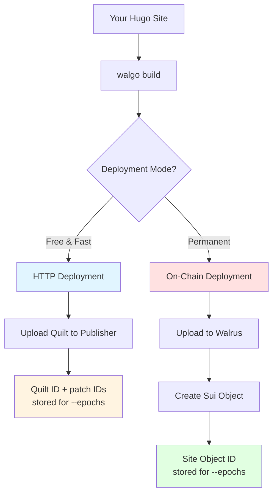
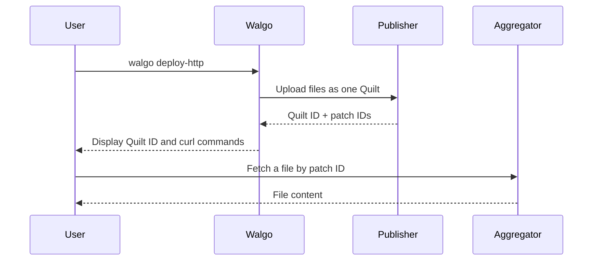
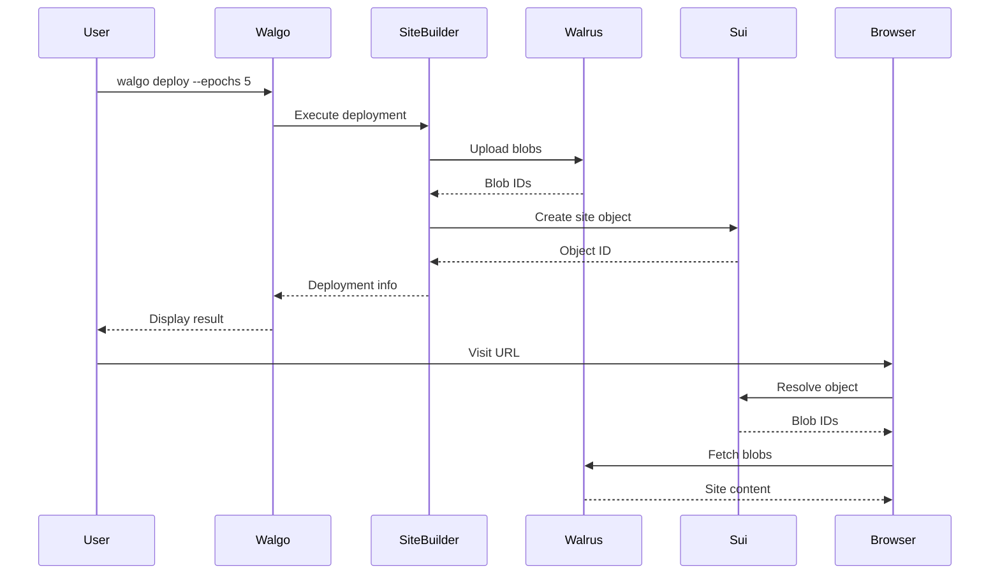
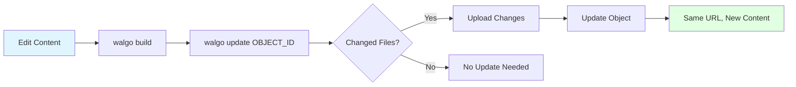

# Deployment Guide

Complete guide for deploying sites to Walrus using Walgo.

## Table of Contents

- [Deployment Overview](#deployment-overview)
- [HTTP Deployment](#http-deployment)
- [On-Chain Deployment](#on-chain-deployment)
- [Updating Deployments](#updating-deployments)
- [Custom Domains](#custom-domains)
- [Best Practices](#best-practices)
- [Cost Optimization](#cost-optimization)

## Deployment Overview

Walgo supports two deployment modes:



### Comparison

| Feature | HTTP Mode | On-Chain Mode |
|---------|-----------|---------------|
| **Cost** | Free | Requires SUI and WAL tokens |
| **Setup** | None | Wallet configuration |
| **Speed** | Fast (5-15s) | Moderate (30-60s) |
| **Permanence** | `--epochs` (default 1) | `--epochs` (default 1, max 53) |
| **Updates** | Re-deploy only | Update in place |
| **Custom Domain** | No | Yes (via SuiNS, mainnet only) |
| **Object ID** | No (Quilt ID only) | Yes |
| **Best For** | Testing, previews | Production sites |

## HTTP Deployment

Perfect for testing and temporary sites.

### Prerequisites

- Hugo installed
- Site built with `walgo build`
- Internet connection
- A publisher URL and an aggregator URL (see the [public services](https://docs.wal.app/docs/usage/web-api#public-services))

**No wallet or cryptocurrency required!**

### Basic HTTP Deployment

```bash
# Build your site
walgo build

# Deploy via HTTP (testnet)
walgo deploy-http \
  --publisher https://publisher.walrus-testnet.walrus.space \
  --aggregator https://aggregator.walrus-testnet.walrus.space \
  --epochs 1
```

`--publisher` and `--aggregator` are required. `walgo deploy-http` builds the site again, then uploads the publish directory to the publisher as one Quilt.

### Output Example

```
...
✅ HTTP deploy complete!
📦 Quilt ID: <quilt-id>

📂 Files stored on Walrus:
  ✓ index.html
  ✓ css/style.css
...

📥 To fetch individual files (for testing):
  📥 curl https://aggregator.walrus-testnet.walrus.space/v1/blobs/by-quilt-patch-id/<patch-id> > index.html
...
```

### Custom Publisher/Aggregator

```bash
# Use custom endpoints
walgo deploy-http \
  --publisher https://custom-publisher.walrus.site \
  --aggregator https://custom-aggregator.walrus.site
```

### HTTP Deployment Workflow



### Limitations

1. **Temporary** - Stored for `--epochs` epochs (default 1). An epoch is 1 day on testnet
2. **No updates** - Must re-deploy (gets new Quilt ID)
3. **No custom domains** - Can't use SuiNS
4. **No ownership** - Can't prove site ownership
5. **Files, not a website** - The aggregator serves each file by its patch ID, for testing with `curl`

### When to Use HTTP Mode

- **Testing** - Try before on-chain deployment
- **Previews** - Share with stakeholders
- **Learning** - Practice without spending tokens
- **Temporary** - Short-lived content

## On-Chain Deployment

Permanent, updateable deployments on Sui blockchain.

### Prerequisites

1. **Sui Wallet** - Configured with the `sui` CLI
2. **SUI and WAL Tokens** - SUI for gas, WAL for storage
3. **site-builder** - Installed via `walgo setup-deps` and configured with `walgo setup`
4. **Built Site** - Ready in the publish directory (`public/` by default)

### First-Time Setup

#### Step 1: Install Dependencies

```bash
walgo setup-deps
```

This installs:
- Walrus site-builder
- Walrus CLI
- Sui CLI

#### Step 2: Configure site-builder and Wallet

```bash
# For testnet
walgo setup --network testnet

# For mainnet (use with caution!)
walgo setup --network mainnet
```

`walgo setup` writes `~/.config/walrus/sites-config.yaml` for that network. It does not create a wallet. If you don't have a Sui wallet yet, run `sui client` and follow its prompts to:
1. Generate new wallet
2. Save recovery phrase (IMPORTANT!)
3. Note wallet address

Deployments go to the active Sui environment. Switch it with `sui client switch --env testnet` or `sui client switch --env mainnet`.

#### Step 3: Get Testnet SUI and WAL

Visit the Sui faucet:
```
https://faucet.sui.io/?address=<your-wallet-address>
```

Then exchange some SUI for WAL:
```
walrus get-wal --context testnet
```

#### Step 4: Verify Balance

```bash
walgo doctor
```

Check that the Sui configuration section shows SUI and WAL balances.

### Basic On-Chain Deployment

```bash
# Build your site
walgo build

# Deploy with default settings (1 epoch)
walgo deploy
```

`walgo deploy` needs the publish directory to exist, builds the site again, and then uploads it.

### Advanced Deployment Options

#### Custom Epoch Count

An epoch is 1 day on testnet and 2 weeks on mainnet. The maximum is 53 epochs.

```bash
# Deploy for 1 epoch (1 day on testnet, 2 weeks on mainnet)
walgo deploy --epochs 1

# Deploy for 10 epochs (10 days on testnet, 20 weeks on mainnet)
walgo deploy --epochs 10

# Deploy for 53 epochs (the maximum, about 2 years on mainnet)
walgo deploy --epochs 53
```

**Cost increases with epochs!**

#### Custom Gas Budget

`walgo deploy` has no gas flag. site-builder reads the gas budget from `~/.config/walrus/sites-config.yaml`. `walgo setup` downloads that file from the `MystenLabs/walrus-sites` GitHub repository, and writes its own copy with `gas_budget: 500000000` only when the download fails. Edit `gas_budget` to change it:

```yaml
# ~/.config/walrus/sites-config.yaml
contexts:
  testnet:
    general:
      gas_budget: 500000000
```

#### Deploy from Custom Directory

Set the publish directory in `walgo.yaml`. `walgo build` writes the site there, and `walgo deploy` uploads it:

```yaml
# walgo.yaml - deploy from dist/ instead of public/
hugo:
  publishDir: dist
```

### Deployment Output

```
🚀 Deploying to Walrus Sites...
  [1/5] Verifying site...
  [2/5] Checking environment...
...
✓ Metadata prepared in ws-resources.json
...
  ✓ Deployment completed in 34s
...
✓ Saved object_id to ws-resources.json
✓ Updated walgo.yaml with Object ID
...
📄 Site Object ID: 0x7b5a8d3f2c1e9b4a6f5d8c2e1a3b7f9d4c6e8a1b5d7f3c9e2a8b4f6d1c5e7a3b
...
```

### Save Deployment Info

`walgo deploy` saves the object ID for you, in `walrus.projectID` in `walgo.yaml` and in `ws-resources.json` in the publish directory. The next `walgo deploy` or `walgo update` finds it there and updates the same site. To deploy a new site instead, run `walgo deploy --force-new`.

### On-Chain Deployment Workflow



## Updating Deployments

Only available for on-chain deployments.

### Why Update Instead of Redeploy?

- **Same URL** - Users keep the same link
- **Lower Cost** - Only pay for changed files
- **Preserve Object ID** - Ownership remains
- **Custom Domains** - No need to re-link SuiNS

### Basic Update

```bash
# Make changes to your site
# ... edit content ...

# Rebuild
walgo build

# Update existing deployment
walgo update 0x7b5a...
```

Without an argument, `walgo update` takes the object ID from `ws-resources.json`, then from `walrus.projectID` in `walgo.yaml`. It stores the new files for `--epochs` epochs (default 1).

### Update Output

```
🚀 Executing update command...
ℹ️  Using object ID from command argument: 0x7b5a8d3f2c1e9b4a6f5d8c2e1a3b7f9d4c6e8a1b5d7f3c9e2a8b4f6d1c5e7a3b
...
ℹ️  Analyzing changes...
...
💾 Storing for 1 epoch(s)
...
📦 Updating metadata...
  ✓ ObjectID saved to ws-resources.json
  ✓ Updated walgo.yaml
```

### Update Workflow



### Checking Before Update

```bash
# Check current status
walgo status 0x7b5a...

# Rebuild, then preview the update without uploading
walgo build
walgo update 0x7b5a... --dry-run

# See what changed (Hugo's diff)
git diff
```

### Update Best Practices

1. **Test locally first** - Use `walgo serve`
2. **Preview the update** - Run `walgo build`, then `walgo update --dry-run` to list the changed files. The dry run does not build the site.
3. **Check status** - Verify site is active
4. **Keep the object ID** - `walgo deploy` and `walgo update` save it in `walgo.yaml`
5. **Monitor costs** - Large updates cost more

## Custom Domains

Use SuiNS domains for human-readable URLs.

### Prerequisites

1. **Own a SuiNS domain** - Register at [suins.io](https://suins.io)
2. **On-chain deployment on mainnet** - SuiNS is mainnet only
3. **Sui wallet** - Configured and funded

For detailed instructions, see the [SuiNS tutorial](https://docs.wal.app/docs/walrus-sites/tutorial-suins).

### Linking Domain to Site

Walgo does not link domains itself. You link the domain on [suins.io](https://suins.io), and `walgo domain` prints the steps with your site's object ID from `walgo.yaml`:

```bash
# Print the linking steps
walgo domain myblog
```

### Output

```
🌐 SuiNS Domain Configuration (Mainnet)
━━━━━━━━━━━━━━━━━━━━━━━━━━━━
📄 Object ID: 0x7b5a8d3f2c1e9b4a6f5d8c2e1a3b7f9d4c6e8a1b5d7f3c9e2a8b4f6d1c5e7a3b
ℹ️  Domain: myblog

📝 Setup Steps:

  1  Visit SuiNS:
      • https://suins.io

  2  Select domain: myblog

  3  Click 'Link To Walrus Site'

  4  Enter Object ID: 0x7b5a8d3f2c1e9b4a6f5d8c2e1a3b7f9d4c6e8a1b5d7f3c9e2a8b4f6d1c5e7a3b

  5  Approve transaction in your wallet

━━━━━━━━━━━━━━━━━━━━━━━━━━━━

ℹ️  For detailed guide: https://docs.wal.app/docs/walrus-sites/tutorial-suins
✅ Your site will be available at: https://myblog.wal.app
```

If the site is on testnet, `walgo domain` says that SuiNS needs a mainnet deployment and suggests `walgo launch`.

### Managing Domains

Manage, renew, and unlink domains on [suins.io](https://suins.io) under "Names You Own".

### Update Configuration

You can record the domain in `walgo.yaml`. Walgo does not read this value.

```yaml
# walgo.yaml
walrus:
  suinsDomain: "myblog.sui"
```

## Best Practices

### 1. Development Workflow

```bash
# Recommended flow
walgo build                    # Build locally
walgo serve                    # Test locally
# To skip the optimizer while debugging, set optimizer.enabled: false in walgo.yaml
walgo deploy-http --publisher <url> --aggregator <url>   # Test on Walrus HTTP
# ... verify everything works ...
walgo build                    # Build with optimization
walgo deploy --epochs 5        # Deploy on-chain
```

### 2. Version Control

```bash
# Track deployments in Git
echo "# Deployments
- Testnet: 0x7b5a...
- Mainnet: 0x9c8d...
" > DEPLOYMENTS.md

git add DEPLOYMENTS.md
git commit -m "Add deployment info"
```

### 3. Configuration Management

```yaml
# walgo.yaml - Track deployment info
walrus:
  projectID: "0x7b5a..."    # Object ID, saved by walgo deploy
  network: "testnet"        # Must match the active Sui environment
  suinsDomain: "myblog.sui" # Track custom domain
```

Epochs are not a `walgo.yaml` setting. Pass `--epochs` to `walgo deploy` or `walgo update` each time.

### 4. Multi-Environment Strategy

Walgo reads `walgo.yaml` from the current directory, and `walgo deploy` deploys to the active Sui environment. If `walrus.network` is set, it must match that environment, or the deploy stops.

```bash
# Development (HTTP only)
walgo deploy-http \
  --publisher https://publisher.walrus-testnet.walrus.space \
  --aggregator https://aggregator.walrus-testnet.walrus.space

# Staging (testnet, 1 epoch)
sui client switch --env testnet
walgo deploy --epochs 1

# Production (mainnet, 53 epochs)
sui client switch --env mainnet
# Set walrus.network: mainnet in walgo.yaml first
walgo deploy --epochs 53 --force-new
```

`--force-new` makes the first mainnet deploy create a new site instead of updating the testnet one. `walgo deploy` then replaces the object ID in `walgo.yaml` with the mainnet one, so record the testnet ID first (see Version Control above).

### 5. Pre-Deployment Checklist

- [ ] Content reviewed and finalized
- [ ] Local preview tested (`walgo serve`)
- [ ] Optimization tested (`walgo build`)
- [ ] HTTP deployment tested (`walgo deploy-http`)
- [ ] Configuration file updated
- [ ] Sufficient SUI balance (`walgo doctor`)
- [ ] Correct network selected (testnet/mainnet)
- [ ] Epoch count decided

### 6. Post-Deployment Checklist

- [ ] Object ID saved in `walgo.yaml`
- [ ] URL tested in browser
- [ ] All pages/links working
- [ ] Images loading correctly
- [ ] Custom domain linked (if applicable)
- [ ] Deployment documented
- [ ] Git commit created

## Cost Optimization

### Understanding Costs

On-chain deployments have two costs:

1. **Storage Cost** - Paid in WAL, based on data size and epochs
2. **Gas Fee** - Paid in SUI, a transaction fee per deployment

```
Total Cost = (File Size × Epochs × Storage Rate) + Gas Fee
```

### Reducing Storage Costs

#### 1. Optimize Assets

```bash
# Hugo minifies, then the walgo optimizer runs (optimizer.enabled: true by default)
walgo build
```

`walgo build` prints the bytes the optimizer saved for each file type.

#### 2. Compress Images

Before deployment:

```bash
# Use ImageOptim, TinyPNG, or similar tools
# Or Hugo's image processing:
# https://gohugo.io/content-management/image-processing/
```

Image optimization can save 50-80% on image files.

#### 3. Remove Unused Files

`walgo deploy` rebuilds the publish directory before it uploads, so files you delete there come back. List them in `compress.ignorePatterns` in `walgo.yaml` instead, and site-builder skips them:

```yaml
# walgo.yaml
compress:
  ignorePatterns:
    - "/downloads/*"
```

Source maps in `/`, `/js/`, `/css/`, and `/assets/` are skipped by default.

#### 4. Choose Appropriate Epochs

On mainnet, one epoch is 2 weeks:

| Duration | Epochs | Use Case |
|----------|--------|----------|
| 2 weeks | 1 | Testing, short-term |
| ~3 months | 6 | Seasonal content |
| ~6 months | 13 | Medium-term projects |
| ~1 year | 26 | Annual content |
| ~2 years | 53 (maximum) | Long-term blogs |

**Don't over-provision!** You can always update/extend.

### Reducing Update Costs

#### 1. Batch Changes

```bash
# Bad - Multiple small updates
walgo update 0x7b5a...  # Update 1
# ... make more changes ...
walgo update 0x7b5a...  # Update 2
# ... more changes ...
walgo update 0x7b5a...  # Update 3

# Good - Batch changes
# ... make all changes ...
walgo build
walgo update 0x7b5a...  # Single update
```

#### 2. Test Before Update

```bash
# Test with HTTP first (free)
walgo build
walgo deploy-http \
  --publisher https://publisher.walrus-testnet.walrus.space \
  --aggregator https://aggregator.walrus-testnet.walrus.space
# ... verify changes ...
# Then update on-chain
walgo update 0x7b5a...
```

### Cost Estimates

`walgo deploy` and `walgo update` print an estimate for your site before they upload, and `walgo launch` shows one before you confirm. After a deploy, walgo looks up the wallet's latest transaction through the Sui GraphQL API and prints the WAL and SUI it spent.

**Note:** Rates are approximate and may change.

## Troubleshooting

### "Insufficient funds" Error

```bash
# Check balance
walgo doctor

# Get testnet SUI
# Visit https://faucet.sui.io (see setup section)

# Or reduce epochs
walgo deploy --epochs 1
```

### Deployment Timeout

`walgo deploy` has no timeout flag. It stops a deployment after 30 minutes.

```bash
# Check your tools and balances
walgo doctor

# Retry with detailed output
walgo deploy --verbose
```

### "site-builder not found"

```bash
# Install dependencies
walgo setup-deps
```

### Update Fails with "Object not found"

`walgo status` and `walgo update` use the active Sui environment, so an object ID from the other network is not found.

```bash
# Verify object ID
walgo status 0x7b5a...

# Check network
sui client active-env

# Ensure you're on correct network
sui client switch --env testnet
walgo update 0x7b5a...
```

### Site Not Loading

1. **Wait a moment** - Propagation takes 10-30 seconds
2. **Check status** - `walgo status 0x7b5a...`
3. **Try direct URL** - Use blob ID URL, not custom domain
4. **Clear browser cache** - Force reload (Ctrl+F5)

## Related Documentation

- [Getting Started Guide](GETTING_STARTED.md) - Your first deployment
- [Configuration Reference](CONFIGURATION.md) - All deployment options
- [Commands Reference](COMMANDS.md) - Command details
- [Troubleshooting Guide](TROUBLESHOOTING.md) - Common issues

## Additional Resources

- **Walrus Documentation:** [https://docs.walrus.site](https://docs.walrus.site)
- **Sui Documentation:** [https://docs.sui.io](https://docs.sui.io)
- **SuiNS:** [https://suins.io](https://suins.io)
- **Sui Faucet:** [faucet.sui.io](https://faucet.sui.io)
