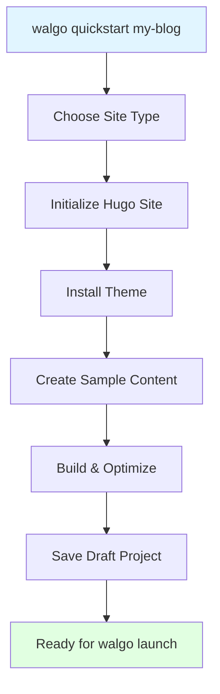

# Quickstart Guide

Create and build a new site with one command, then deploy it when you are ready.

## One Command to Rule Them All

```bash
walgo quickstart my-blog
```

This single command will:

1. ✓ **Ask** which site type to create: Biolink (the default), Blog, Docs, or Whitepaper
2. ✓ **Create** a new Hugo site in `my-blog/` and write `walgo.yaml`
3. ✓ **Install** the theme for that site type from GitHub
4. ✓ **Add** sample content
5. ✓ **Build** and optimize your site into `public/`
6. ✓ **Save** the site as a draft project in `walgo projects`

Quickstart does not deploy. When the site looks right, deploy it with `walgo launch`.

## What You Get

### Site Types

The site type picks the theme and the sample content:

| Choice | Site type | Theme | Sample content |
|--------|-----------|-------|----------------|
| `1` (default) | Biolink | [Walgo Biolink](https://github.com/ganbitlabs/walgo-biolink) | The theme's example site |
| `2` | Blog | [Ananke](https://github.com/theNewDynamic/gohugo-theme-ananke) | A homepage, `content/_index.md` |
| `3` | Docs | [Book](https://github.com/alex-shpak/hugo-book) | The theme's example site |
| `4` | Whitepaper | [Walgo Whitepaper](https://github.com/ganbitlabs/walgo-whitepaper) | The theme's example site |

If the theme download fails, quickstart prints a warning and creates a blank theme with `hugo new theme` instead.

### Complete Setup

A Blog site looks like this (Hugo's empty directories are left out):

```
my-blog/
├── archetypes/
│   └── default.md
├── content/
│   └── _index.md              # Homepage
├── static/
│   └── favicon.svg
├── themes/
│   └── ananke/                # Downloaded theme
├── hugo.toml                  # Hugo configuration
├── walgo.yaml                 # Walgo configuration
└── public/                    # Built site (optimized)
```

### Sample Content
Your site comes with:
- **Blog** - A homepage (`content/_index.md`) that explains how to edit, preview, and deploy the site
- **Biolink, Docs, Whitepaper** - The theme's example site, including its content and configuration

## Usage Examples

### Basic Quickstart

```bash
walgo quickstart my-blog
```

Output when you choose Blog (Hugo and theme download messages left out):
```
🚀 Walgo Quick Start
━━━━━━━━━━━━━━━━━━━━━━━━━━━━
📦 Creating site: my-blog

Site type:
  1) Biolink
  2) Blog
  3) Docs
  4) Whitepaper
Select [1]: 2

  [1/4] Checking dependencies...
        ✓ Hugo found

  [2/4] Creating Hugo site...
        ✓ Hugo site initialized
        ✓ Walgo config created

  [3/4] Setting up site...
        ✓ Config set up (blog)
        ✓ Archetypes set up
        ✓ Favicon set up
        🔄 Installing theme Ananke...
        ✓ Theme Ananke installed

  [4/4] Creating sample content...
        ✓ Homepage created

  Building site...
        ✓ Site built
   ✓ Created draft project

━━━━━━━━━━━━━━━━━━━━━━━━━━━━
✅ Quick start complete!
━━━━━━━━━━━━━━━━━━━━━━━━━━━━
📂 Site directory: my-blog/
📦 Built files: public/

💡 Next steps:
   - cd my-blog
   - walgo serve      # Preview your site locally
   - walgo launch     # Deploy with interactive wizard
```

### Skip the Build

```bash
# Create the site and sample content, but don't build yet
walgo quickstart my-blog --skip-build
```

Run `walgo build` in the site directory when you want the built files.

### With a Different Theme

Quickstart always installs the theme for the site type. To switch themes afterwards, run `walgo theme install` with the theme's GitHub URL:

```bash
cd my-blog
walgo theme install https://github.com/CaiJimmy/hugo-theme-stack
walgo build
```

`walgo theme install` removes the themes in `themes/`, downloads the new one, and sets `theme` in your TOML Hugo config (such as `hugo.toml`).

### On-Chain Deployment

```bash
cd my-blog
walgo launch
```

`walgo launch` walks you through the network, the wallet, the project name, the storage epochs, and the gas fee, then publishes the site.

**Note:** Requires a Sui wallet with an active address. Run `sui client` to create one. `walgo setup --network testnet` writes the site-builder configuration, but it does not create a wallet.

## What Happens Behind the Scenes



### Detailed Steps

1. **Choose a Site Type**

   Quickstart prompts for the site type. Press Enter to choose Biolink.

2. **Initialize Hugo Site**
   ```bash
   # Equivalent to:
   mkdir my-blog
   cd my-blog
   hugo new site . --format toml
   ```
   Quickstart then writes `walgo.yaml` with the default settings. If the active Sui environment is `testnet` or `mainnet`, it also sets `walrus.network` to match.

3. **Install Theme**
   - Downloads the theme's GitHub archive into `themes/`
   - Updates the Hugo config with settings for that theme
   - Blog sites also get Walgo's `hugo.toml` template and archetypes
   - Adds a favicon in the place the theme expects

4. **Create Sample Content**
   - Blog: writes `content/_index.md`
   - Biolink, Docs, Whitepaper: copies the theme's `exampleSite` content and configuration into the site

5. **Build & Optimize**
   ```bash
   # Equivalent to:
   walgo build
   ```
   `--skip-build` skips this step.

6. **Save Draft Project**

   Quickstart adds the site to your project list as a draft. `walgo projects` lists it.

## Next Steps

After quickstart completes:

### 1. Navigate to Your Site

```bash
cd my-blog
```

### 2. Preview Locally

```bash
walgo serve
# Opens http://localhost:1313
```

### 3. Customize Content

```bash
# Edit the homepage
vim content/_index.md

# Create a new post
hugo new posts/my-first-real-post.md
```

### 4. Customize Theme

Edit `hugo.toml`. A Blog site starts with settings like these:

```toml
baseURL = "/"
title = "my-blog"
languageCode = "en-us"
theme = "ananke"

# Ananke theme params
[params]
  favicon = "/favicon.svg"
  author = ""
  description = "A blog powered by Walgo"
  show_reading_time = true
```

### 5. Rebuild and Redeploy

```bash
# Make your changes, then:
walgo build
walgo deploy --epochs 5
```

## Command Options

### Available Flags

| Flag | Type | Default | Description |
|------|------|---------|-------------|
| `--skip-build` | bool | `false` | Skip building |

### Examples with Flags

```bash
# Setup only (no build)
walgo quickstart blog --skip-build
```

## Popular Themes

Quickstart installs the theme for the site type you choose. After that, you can switch to any Hugo theme on GitHub with `walgo theme install`. Here are some popular ones:

### PaperMod
```bash
walgo theme install https://github.com/adityatelange/hugo-PaperMod
```
- Fast, clean blog theme
- Great for blogs and documentation
- Repository: https://github.com/adityatelange/hugo-PaperMod

### Stack
```bash
walgo theme install https://github.com/CaiJimmy/hugo-theme-stack
```
- Card-based design
- Perfect for image-heavy blogs
- Repository: https://github.com/CaiJimmy/hugo-theme-stack

### Ananke (Blog default)
```bash
walgo theme install https://github.com/theNewDynamic/gohugo-theme-ananke
```
- Default Hugo theme
- Simple and elegant
- Repository: https://github.com/theNewDynamic/gohugo-theme-ananke

### Terminal
```bash
walgo theme install https://github.com/panr/hugo-theme-terminal
```
- Hacker aesthetic
- Terminal-inspired design
- Repository: https://github.com/panr/hugo-theme-terminal

## Frequently Asked Questions

### Can I use quickstart with an existing Hugo site?

No, quickstart is for creating new sites. For existing sites, use:

```bash
cd existing-site
walgo build
walgo deploy
```

### What if I don't like the theme?

You can change it anytime:

```bash
cd my-blog
walgo theme install https://github.com/CaiJimmy/hugo-theme-stack
walgo build
walgo deploy
```

### How do I deploy on-chain after using quickstart?

```bash
cd my-blog
walgo setup --network testnet  # If not already done
walgo deploy --epochs 5
```

### Does quickstart deploy my site?

No. Quickstart stops after the build. Deploy later:

```bash
cd my-blog
walgo launch
```

### What is Walrus Sites deployment?

Walrus Sites deployment creates a proper decentralized website with:
- **Cost**: Requires SUI tokens for on-chain storage
- **Duration**: Configurable epochs (storage time)
- **Updates**: Update in place (same object ID)
- **Custom Domain**: Yes (via SuiNS names)
- **Content-Type Headers**: Proper MIME types for browser rendering

For testing without SUI tokens, you can use `walgo deploy-http` for raw file storage, but those URLs are meant for curl/testing, not browsing.

### How do I add my own content?

```bash
cd my-blog

# Create new post
hugo new posts/my-topic.md

# Edit the post
vim content/posts/my-topic.md

# Set draft: false when ready
# Then rebuild and deploy
walgo build
walgo deploy
```

### Can I customize the sample content?

The sample content is just to get you started. Feel free to:
- Edit the sample pages
- Delete them entirely
- Create your own from scratch

A Blog site has one sample page, `content/_index.md`. The other site types copy the theme's example pages into `content/`.

## Troubleshooting

### "Hugo not found"

Install Hugo first:

```bash
# macOS
brew install hugo

# Linux
sudo apt install hugo

# Windows
scoop install hugo-extended
```

### Theme installation fails

Quickstart downloads the theme from GitHub. If the download fails, it prints a warning and creates a blank theme, so the site builds without the theme's layouts.

Check internet connection:

```bash
# Test connection
ping github.com

# Install the theme again (Blog example)
cd my-blog
walgo theme install https://github.com/theNewDynamic/gohugo-theme-ananke
```

Each download attempt times out after 2 minutes. On a slow connection, raise the limit with `WALGO_THEME_DOWNLOAD_TIMEOUT`, which takes a Go duration such as `5m`.

### Deployment fails

Check diagnostics:

```bash
walgo doctor
```

Common issues:
- Network connectivity
- Firewall blocking connections
- Walrus service downtime

## Comparison: Quickstart vs Manual

| Aspect | Quickstart | Manual Setup |
|--------|-----------|--------------|
| **Commands** | 1 command | 5+ commands |
| **Time** | ~2 minutes | ~10 minutes |
| **Theme** | Auto-installed | Manual install |
| **Content** | Sample included | Create yourself |
| **Configuration** | Auto-configured | Manual editing |
| **Deployment** | Separate step (`walgo launch`) | Separate step |
| **Best For** | Beginners, prototypes | Customization, existing sites |

### Manual Setup Equivalent

The quickstart command replaces all of this:

```bash
# Manual setup (what quickstart does for you)
walgo init my-blog
cd my-blog
walgo theme install https://github.com/theNewDynamic/gohugo-theme-ananke
# Edit hugo.toml to configure the theme
# Write content/_index.md
walgo build
```

**Quickstart = 1 command instead of all these steps!**

## Learn More

- **Full Documentation:** [docs/](https://github.com/ganbitlabs/walgo/tree/main/docs)
- **Commands Reference:** [COMMANDS.md](COMMANDS.md#walgo-quickstart-site-name)
- **Getting Started Guide:** [GETTING_STARTED.md](GETTING_STARTED.md)
- **Deployment Guide:** [DEPLOYMENT.md](DEPLOYMENT.md)

## Ready to Start?

```bash
# Install Walgo (if you haven't)
curl -fsSL https://raw.githubusercontent.com/ganbitlabs/walgo/main/install.sh | bash

# Create your site
walgo quickstart my-blog

# Preview it, then deploy
cd my-blog
walgo serve
walgo launch
```

---

**Need help?** Check the [Troubleshooting Guide](TROUBLESHOOTING.md) or [open an issue](https://github.com/ganbitlabs/walgo/issues).
